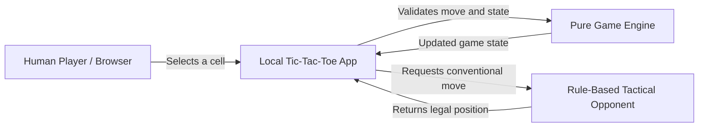
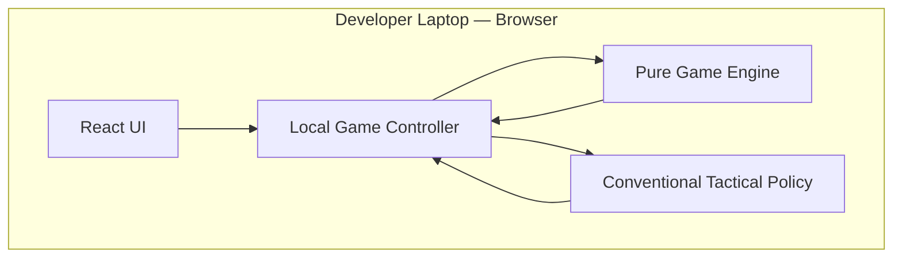
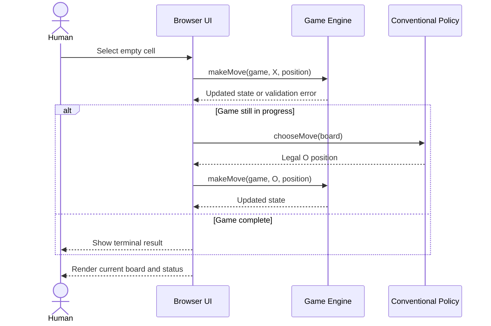
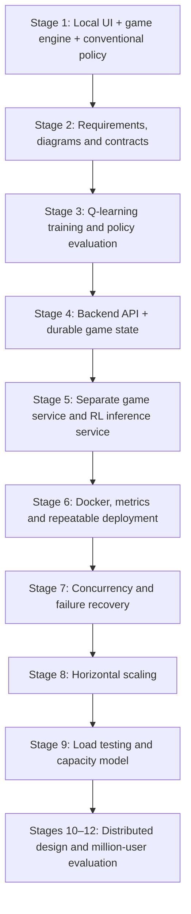

# Chapter 2 — System Context and Architecture

## 2.1 Purpose
This chapter establishes the system boundary and documents the architecture at each level of detail. Diagrams describe the current stage and the intended evolution; they must not imply that future services already exist.

## 2.2 System context — Stage 1

Stage 1 has one human and one conventional opponent. There is no second human player, backend server, database, or network communication.

## 2.3 Stage 1 component view

The UI renders state and collects input. The controller coordinates a turn. The game engine enforces game rules. The conventional policy selects a move from the current board. Keeping these responsibilities separate will make it possible to replace the baseline policy with an RL inference client later.

## 2.4 Stage 1 move sequence

## 2.5 Planned architecture evolution

## 2.6 Key architectural decisions

### ADR-001: Human vs AI only
**Decision:** The application supports a single human playing against an AI opponent at every stage. Stage 1 uses conventional logic; later stages use the trained RL policy.

**Reason:** This is the product's core constraint and keeps the RL agent central to the project.

### ADR-002: Conventional baseline before RL
**Decision:** Start with a transparent tactical policy that wins if possible, blocks an immediate human win, prefers center, then corners, then edges.

**Reason:** It establishes a working product and a baseline for comparison. It is not intended to be the final AI.

### ADR-003: Keep the game engine independent
**Decision:** Game rules are pure functions, independent of React, Express, databases, and model-serving infrastructure.

**Reason:** This allows identical rules to be reused by the local application and later server-side game service.

### ADR-004: Separate training from inference
**Decision:** Training and evaluation are offline jobs; online gameplay calls a versioned inference interface.

**Reason:** Training can be computationally variable and should not block a player's move request. The deployed policy must be reproducible and replaceable.

### ADR-005: Delay distributed infrastructure
**Decision:** Add persistence, Redis, brokers, multiple instances, and regional infrastructure only after the relevant requirements and bottlenecks are established.

**Reason:** Premature distribution increases failure modes and makes performance harder to reason about.

## 2.7 Stage 1 limitation
The current application is a local prototype. Its game state is in browser memory, so refresh resets the game. It has no authentication, persistence, server-side enforcement, RL model, or concurrency capability. Those are explicit future milestones, not current features.
